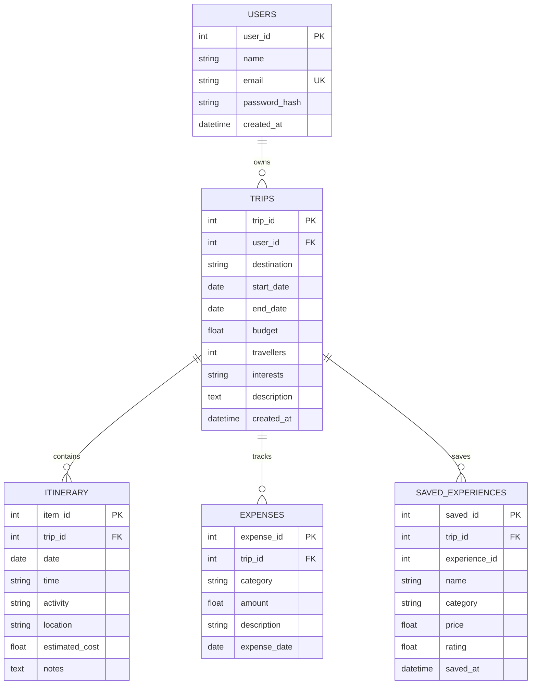

# Smart Travel Planner — Full-Stack Web Application

A complete, modern, and production-ready **Smart Travel Planner** web application engineered with **FastAPI**, **SQLAlchemy**, **SQLite**, **Pydantic**, **HTTPX**, and **Vanilla JavaScript + Jinja2**.

Developed as an **Advanced Python** college capstone project, demonstrating clean software engineering, REST API design, microservice communication, secure JWT authentication, and interactive client UX.

---

## 🌟 Key Capabilities

1. **User Authentication & Security**:
   - Secure password hashing using `bcrypt`.
   - Signed JSON Web Tokens (JWT) for stateless REST API access and cookie-based web sessions.
   - User ownership isolation: users can only view and modify their own trips.

2. **Trip Management**:
   - Create, view, update, and delete travel itineraries.
   - Configure destinations, calendar date ranges, group traveler counts, target budget (INR ₹), and travel interest tags (*Beach, Adventure, Food, Culture, Shopping, Nature, Nightlife, History, Relaxation*).

3. **Day-by-Day Itineraries**:
   - Chronological timeline sorting by date and time.
   - Activity scheduling with location details, cost estimates, and custom notes.

4. **Dynamic Budget & Expense Tracking**:
   - Real-time mathematical calculation of total spent and remaining budget:
     $$\text{Total Spent} = \sum \text{Expenses}$$
     $$\text{Remaining Budget} = \text{Budget} - \text{Total Spent}$$
     $$\text{Budget Used \%} = \left(\frac{\text{Total Spent}}{\text{Budget}}\right) \times 100$$
   - Visual progress gauges with automatic warning states when budget thresholds are exceeded.
   - Categorized subtotals across *Food*, *Transport*, *Hotel*, *Activities*, *Shopping*, and *Other*.

5. **External Microservice Integration (Experience Finder API)**:
   - Strict 3-tier boundary: Browser $\to$ Smart Travel Planner FastAPI $\to$ Experience Finder REST API.
   - Asynchronous HTTP client using `httpx.AsyncClient` with timeout protection and fallback resilience.
   - Discovered experiences can be saved directly to the trip's database and scheduled into the itinerary.

6. **Profile & Account Settings**:
   - Live user profile inspection (`GET /api/users/me`) and permitted field updates (`PUT /api/users/me`).
   - Secure password update with current password verification.
   - Secure logout endpoint (`POST /api/users/logout`) clearing both authentication cookies and client session storage.
   - Private page protection enforcing authentication across all authenticated views.

7. **Reverse API Integration for Experience Finder**:
   - Dedicated partner integration endpoint: `GET /api/integration/trips/{trip_id}/summary`.
   - Server-to-server authorization using `X-Integration-Key` (`INTEGRATION_API_KEY`).
   - Scope restriction to explicitly permitted demo trips (`DEMO_PERMITTED_TRIP_IDS = [101, 102]`).
   - Strict privacy guarantee: returns **only permitted fields** (*Trip ID, Destination, Start/End Dates, Budget, Selected Itinerary Activities*).
   - **Zero exposure** of passwords, password hashes, JWT tokens, or personal user data.
   - Comprehensive bidirectional audit logging in `API_CALL_HISTORY` and downloadable `API_Communication_History.txt`.

8. **Bidirectional Text File Exchange & Live REST Transfer Verification**:
   - Visibly demonstrates to college faculty that data and physical `.txt` files transfer across the network between the two independent projects.
   - **Planner (:8000) $\to$ Experience Finder (:8001)**: Generates and transfers a full Trip Dossier `.txt` file via HTTP POST `multipart/form-data`.
   - **Experience Finder (:8001) $\to$ Planner (:8000)**: Generates and transfers an Activity Booking Voucher Pack `.txt` file.
   - **Custom File Upload & Download**: Both sides support uploading custom `.txt` files, live text modal preview, and one-click file download attachment serving.
   - **Real-Time Transfer Logs**: Both web portals feature live REST transaction log tables showing timestamps, direction, filename, payload size, and HTTP status.


---

## 🏗️ Architecture & System Boundary

```text
┌────────────────────────────────────────────────────────────────────────┐
│                        CLIENT BROWSER                                  │
│  • Window A: Smart Travel Planner UI (http://localhost:8000)           │
│  • Window B: Experience Finder Partner Portal (http://localhost:8001)  │
└───────────────────────────────────┬────────────────────────────────────┘
                                    │ HTTP / JSON / File Upload
                                    ▼
┌────────────────────────────────────────────────────────────────────────┐
│              SMART TRAVEL PLANNER (FASTAPI BACKEND :8000)              │
│  • SQLAlchemy ORM (SQLite / PostgreSQL)                                │
│  • Authentication & JWT verification                                   │
│  • Budget calculations, Itinerary CRUD, Trip Management                │
│  • File Sync Router: /api/sync/* (Transfer, Receive, Preview, Download)│
│  • Interactive Swagger Docs: /docs                                     │
└───────────────────────────────────┬────────────────────────────────────┘
                                    │ HTTPX (REST API & Multipart Files)
                                    │ Bidirectional Communication
                                    ▼
┌────────────────────────────────────────────────────────────────────────┐
│              EXPERIENCE FINDER SERVICE (:8001)                         │
│  • Independent external REST API & Web Portal (http://localhost:8001)  │
│  • GET /api/experiences?destination=Goa&category=Adventure             │
│  • File Sync Endpoints: /api/sync/* (Receive, Send, Preview, Download) │
│  • Live Audit Logs & Real-time Connectivity Status Monitor             │
└────────────────────────────────────────────────────────────────────────┘
```

> [!IMPORTANT]
> **Architectural Boundary Enforcement**:
> The client web browser **never** makes direct network requests to the Experience Finder application for recommendations. All external discovery calls are mediated by the Smart Travel Planner FastAPI backend using `HTTPX`.
> For file synchronization, the two microservices communicate peer-to-peer over authenticated REST endpoints (`POST /api/sync/receive-file`).

---

## 🗄️ Database Schema

The database is managed using **SQLAlchemy** with relational foreign keys and cascade delete rules:



---

## 🚀 Getting Started

### 1. Prerequisites
- Python 3.10 or higher installed.

### 2. Install Dependencies
```bash
pip install -r requirements.txt
```

### 3. Environment Configuration
Copy the provided `.env.example` to `.env`:
```bash
cp .env.example .env
```
Default `.env` contents:
```ini
DATABASE_URL=sqlite:///./travel_planner.db
SECRET_KEY=college_advanced_python_secret_key_change_in_production_2026
ALGORITHM=HS256
ACCESS_TOKEN_EXPIRE_MINUTES=1440
EXPERIENCE_API_URL=http://localhost:8001
```

### 4. Running the Applications

#### Terminal 1 — Start the Smart Travel Planner Application:
```bash
python -m uvicorn app.main:app --port 8000 --reload
```
Open your browser to:
- **Application Web UI:** [http://localhost:8000](http://localhost:8000)
- **Interactive Swagger Documentation:** [http://localhost:8000/docs](http://localhost:8000/docs)
- **ReDoc Documentation:** [http://localhost:8000/redoc](http://localhost:8000/redoc)

#### Terminal 2 (Optional) — Start the Standalone Experience Finder Service:
```bash
python -m uvicorn mock_experience_finder.main:app --port 8001 --reload
```
Open [http://localhost:8001/docs](http://localhost:8001/docs) to view the independent Experience Finder API.

---

## 🎓 College Viva / Demo Scenario Walkthrough

The application automatically pre-seeds the college examination scenario when first run:

### Step 1: Login
- **Email:** `arun.kumar@example.com`
- **Password:** `password123`

### Step 2: Active Goa Trip
- **Destination:** Goa
- **Dates:** 15 October 2026 – 18 October 2026
- **Travelers:** 3
- **Budget:** ₹25,000
- **Interests:** Adventure, Beach, Food

### Step 3: Verified Automatic Budget Calculations
- **Food Expenses:** ₹2,000 (Dinner: ₹850 + Seafood Lunch: ₹1,150)
- **Transport Expenses:** ₹1,500 (Taxi: ₹650 + Scooter Rental: ₹850)
- **Activity Expenses:** ₹3,700 (Scuba Diving & Watersports combo)
- **Calculated Total Spent:** **₹7,200**
- **Calculated Remaining Budget:** **₹17,800** ($28.8\%$ utilized)

### Step 4: Discover Experiences
1. Navigate to **Recommendations** (`/recommendations.html?id=101`).
2. Smart Travel Planner calls Experience Finder at `http://localhost:8001/api/experiences`.
3. Displays **Scuba Diving** (₹2,500, ⭐ 4.7), **Dolphin Watching** (₹1,200, ⭐ 4.5), and **Baga Beach** (Free, ⭐ 4.6).
4. Click **"+ Add to Trip"**: The experience is permanently saved to the `saved_experiences` table and scheduled into the trip itinerary!

### Step 5: Visible Inter-Project Text File Transfer (Faculty Viva Showcase) 🎓
Show both project windows side-by-side to visibly prove live microservice network communication:
1. **Open Two Browser Tabs/Windows**:
   - Left Window: **Smart Travel Planner** $\to$ Click `Data Exchange (:8001)` in the sidebar (`http://localhost:8000/exchange.html`)
   - Right Window: **Experience Finder Partner Portal** (`http://localhost:8001/`)
2. **Transfer from Project 1 to Project 2 (Planner $\to$ Experience Finder)**:
   - On the Planner window (`:8000`), click **"Transfer Goa Trip Plan to :8001"** (or upload any `.txt` file).
   - In seconds, look at the Experience Finder window (`:8001`):
     - The file immediately appears in the **Inbox of Received Files**!
     - Click **"Preview"** to read the full dossier modal directly in the second application.
     - Click **"Download"** to download the exact `.txt` file onto the examiner's machine!
     - Check the **Live REST Activity Log** showing `INCOMING: SUCCESS (HTTP 200)`.
3. **Transfer from Project 2 to Project 1 (Experience Finder $\to$ Planner)**:
   - On the Experience Finder window (`:8001`), click **"Send Confirmed Voucher Pack to Planner (:8000)"** (or upload a custom `.txt` file).
   - In seconds, look at the Smart Travel Planner window (`:8000`):
     - The file appears in the **Inbox of Files Received from Experience Finder**!
     - Click **"Preview"** or **"Download"** to inspect the `.txt` voucher file.
     - Live REST logs update on both sides.

---

## 📡 REST API Reference

| Method | Endpoint | Description |
|---|---|---|
| `POST` | `/api/users/register` | Register new user account |
| `POST` | `/api/users/login` | Authenticate and obtain JWT token |
| `GET` | `/api/users/me` | Fetch authenticated user profile |
| `PUT` | `/api/users/me` | Update permitted user profile fields (Name, Email, Password) |
| `POST` | `/api/users/logout` | Securely logout user and invalidate session |
| `GET` | `/api/integration/trips/{trip_id}/summary` | **Reverse Partner Integration (Permitted Fields Only, Server-to-Server Auth)** |
| `GET` | `/api/recommendations/history` | Real-time audit log of outbound & inbound API calls |
| `GET` | `/api/recommendations/history/download` | Download full API Communication History as formatted `.txt` |
| `POST` | `/api/trips` | Create a new trip |

| `GET` | `/api/trips` | List all trips for current user |
| `GET` | `/api/trips/{trip_id}` | Retrieve trip details, itinerary, and budget metrics |
| `PUT` | `/api/trips/{trip_id}` | Update trip parameters |
| `DELETE` | `/api/trips/{trip_id}` | Delete trip and cascade data |
| `GET` | `/api/trips/{trip_id}/summary` | Retrieve summary for recommendation engines |
| `POST` | `/api/trips/{trip_id}/itinerary` | Schedule a new itinerary activity |
| `GET` | `/api/trips/{trip_id}/itinerary` | Retrieve activities sorted chronologically |
| `PUT` | `/api/itinerary/{item_id}` | Edit itinerary activity |
| `DELETE` | `/api/itinerary/{item_id}` | Delete activity |
| `POST` | `/api/trips/{trip_id}/expenses` | Log a new travel expense |
| `GET` | `/api/trips/{trip_id}/expenses` | List expenses and category subtotals |
| `PUT` | `/api/expenses/{expense_id}` | Edit logged expense |
| `DELETE` | `/api/expenses/{expense_id}` | Delete expense item |
| `GET` | `/api/trips/{trip_id}/recommendations` | **Proxies Experience Finder REST API** |
| `POST` | `/api/trips/{trip_id}/experiences` | Save discovered experience to trip |
| `GET` | `/api/trips/{trip_id}/experiences` | List saved experiences |
| `DELETE` | `/api/experiences/{saved_id}` | Remove saved experience |
| `GET` | `/api/sync/status` | Heartbeat & ping status check to `:8001` |
| `GET` | `/api/sync/export-trip-text/{trip_id}` | Formats full trip itinerary & budget as `.txt` |
| `POST` | `/api/sync/receive-file` | Receives incoming text file/upload over REST |
| `GET` | `/api/sync/received-files` | Lists received files in inbox |
| `GET` | `/api/sync/download/{file_id}` | Downloads received text file attachment |
| `GET` | `/api/sync/preview/{file_id}` | Returns full text content for modal preview |
| `POST` | `/api/sync/send-file` | Posts `.txt` file/form to `:8001/api/sync/receive-file` |
| `POST` | `/api/sync/transfer-trip/{trip_id}` | One-click export + REST transfer to `:8001` |
| `GET` | `/api/sync/logs` | Live REST transaction audit log |

---

## 🛡️ Security & Error Handling

- Passwords hashed with `bcrypt` work factor salt before database insertion.
- Pydantic models validate all incoming payloads (e.g., date logic: `end_date >= start_date`, `budget > 0`, `travellers > 0`).
- User authorization guards prevent accessing or modifying other users' trips.
- Network timeouts and connection errors to external microservices are trapped with friendly error responses rather than unhandled Python exceptions.
